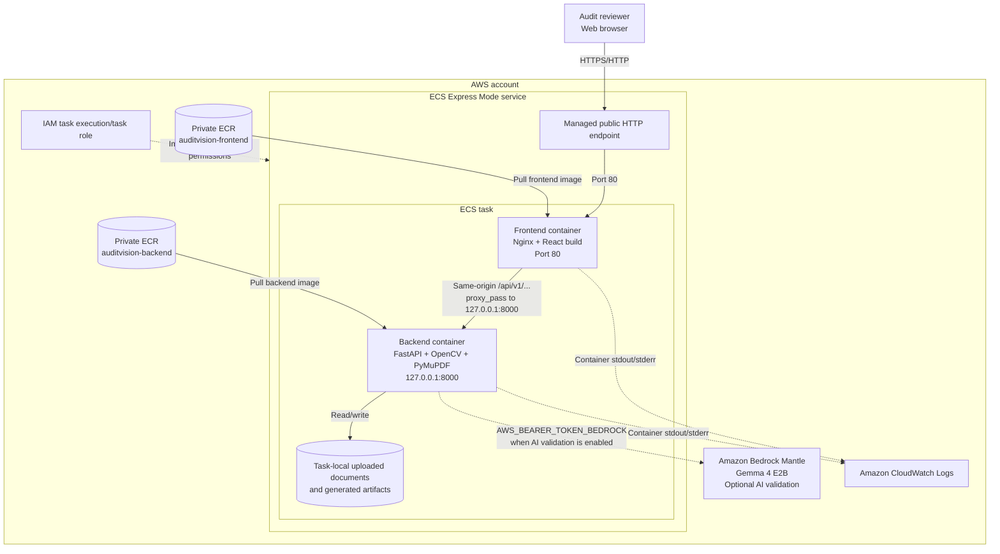

# AuditVision AI architecture

The diagram below reflects the current deployment model: two private ECR
repositories provide the container images, and Amazon ECS Express Mode runs the
frontend and backend as containers in one task. The frontend container serves
the React build through Nginx and proxies API requests to the backend sidecar
over `127.0.0.1:8000`.

## Request flow

1. A reviewer opens the managed ECS Express Mode endpoint.
2. Nginx serves the React production build from the frontend container.
3. Browser requests such as `/api/v1/documents` remain same-origin.
4. Nginx proxies those requests to the backend sidecar at
   `http://127.0.0.1:8000`.
5. FastAPI performs PDF processing and OpenCV detection.
6. If `AUDITVISION_AI_VALIDATION_ENABLED=true`, background validation sends
   bounded detection crops to Bedrock Mantle and stores the result in the
   document artifacts.

## Important deployment notes

- ECR stores images; it does not serve application traffic at runtime.
- The backend port is not publicly published. It is reachable only from the
  frontend container in the same ECS task.
- The current application has no PostgreSQL, Redis, or S3 dependency.
- Task-local document storage is not durable across task replacement. Use an
  S3-backed storage design before relying on uploaded documents as durable
  production records.
- Keep the Bedrock bearer token in ECS secrets or runtime environment
  configuration. Never bake it into either image or the React build.
