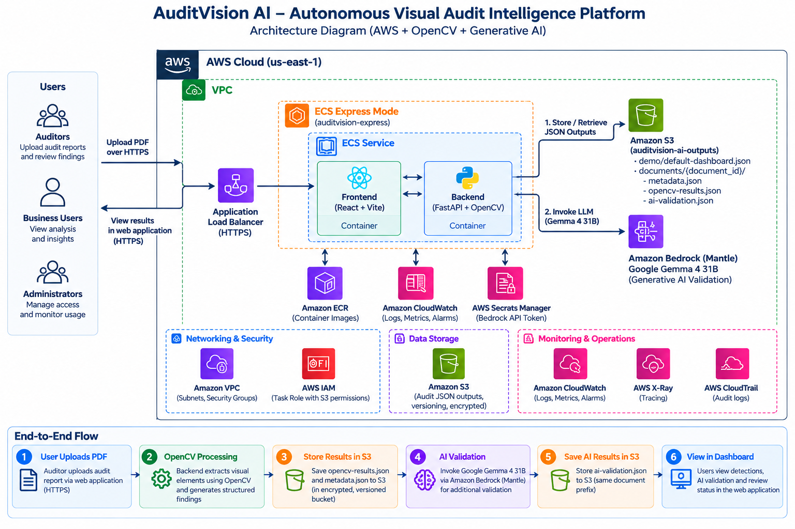
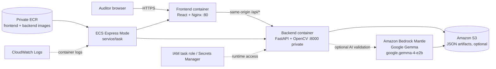

# AuditVision AI

AuditVision AI is a visual audit workbench that combines a React/Nginx
frontend with a FastAPI/OpenCV backend. Auditors upload PDF reports, inspect
detected visual marks, record review decisions, and export JSON, CSV, and
evaluation reports.

## Architecture



The image above is the canonical presentation diagram. The Mermaid version
below provides a searchable, text-based fallback for GitHub and accessibility.



The detailed diagram and request flow are in [ARCHITECTURE.md](ARCHITECTURE.md).
ECR stores images; it does not serve application traffic. In the ECS
single-task layout, Nginx proxies `/api/` to the backend over the private task
network and port 8000 is not published publicly.

## Local development

The normal local mode uses filesystem storage and does not require AWS
credentials:

```bash
docker compose config
docker compose build
docker compose up -d
docker compose ps
```

Open `http://localhost` and use the upload and review workflows. The browser
uses same-origin `/api/...` requests in the production build; Vite development
can use `VITE_API_BASE_URL` from `Frontend/.env.example`.

For local S3 testing, use `compose.s3-local.yaml` and provide credentials
through your local AWS SDK configuration. Do not mount credential files into
the images or commit them.

## Configuration and secrets

- `Backend/.env.example` and `Frontend/.env.example` contain placeholders only.
- Copy an example to a local `.env` when needed; never commit `.env` files.
- Keep `AWS_BEARER_TOKEN_BEDROCK` in a runtime secret store (for example ECS
  Secrets Manager injection), never in source code, Vite variables, or an image.
- AI validation is optional and backend-only. OpenCV detections remain the
  authoritative findings when AI validation is disabled or unavailable.
- S3 mode requires an appropriately scoped runtime IAM role. Local development
  defaults to filesystem storage.

## EC2 Compose deployment

```bash
docker compose config
docker compose build
docker compose up -d
docker compose ps
docker compose logs -f
```

Nginx serves the React build on port 80 and forwards `/api/...` unchanged to
the private backend. Uploaded PDFs and generated artifacts are retained in the
`auditvision-documents` named volume. Use `docker compose down -v` only when
intentionally deleting those persisted uploads.

## Public-release checks

Run these checks from the repository root before publishing:

```bash
docker compose config --quiet
```

```powershell
Set-Location Backend
python -m compileall -q src
Set-Location ..\Frontend
npm.cmd run lint
npm.cmd run build
```

The repository-wide `.gitignore` excludes credentials, virtual environments,
dependency trees, build output, logs, and generated upload artifacts while
leaving checked-in sample data and fixtures available to the sample API.
